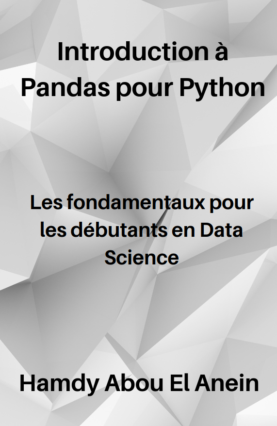

# Programmes du livre : [Introduction à Pandas pour Python : Les fondamentaux pour les débutants en Data Science](https://www.amazon.fr/dp/B0C2S4MZ88)      

Auteur : [Hamdy Abou El Anein](https://www.amazon.fr/Hamdy-Abou-El-Anein/e/B0BM89T88X/ref=aufs_dp_fta_dsk)    

## Maintenance and regression tests

Maintainer: Hamdy Abou El Anein — hamdy.aea@protonmail.com

Install `requirements.txt` in a virtual environment. Run `python3 -m unittest -v` from the repository root. CSV inputs now resolve relative to each example, and generated row numbers adapt to the data length. All 31 chapter programs are executed from a temporary unrelated working directory by the regression suite, with plots using the noninteractive Agg backend. Original chapter organization is retained.
